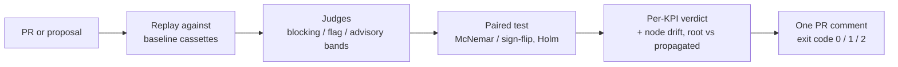

# lgcov on one page

lgcov is a merge gate for LangGraph agents: it tells you, per KPI and per node, whether a
PR is safe to ship — whoever wrote the PR (a human, a coding agent, or an optimiser).

## Input and output

| Input | Output |
|---|---|
| Any PR or proposal: a candidate commit compared with its base. | Per KPI: SHIP, BLOCK or INCONCLUSIVE, with the MDE, the cases needed to detect a drop (`required_n`) and to show non-inferiority (`ni_required_n`). |
| Baseline cassettes recorded from the base, and `taxonomy.yaml` (the KPIs and their judges). | Node drift, each drifted node labelled root or propagated. |
| | Exit code: 0 for SHIP, 1 for BLOCK, 2 for a harness error (INFRA_ERROR). INCONCLUSIVE exits 0 by default and is flagged needs_human in the PR comment; set `fail-on-inconclusive` to make it block. |
| | One PR comment, updated in place on every push. |

## How a verdict is made

- **A paired test per KPI.** Base and candidate answer the same cases. A binary KPI with one
  sample per case gets an exact McNemar test; graded scores or several samples get a paired
  sign-flip test. Each KPI is tested against a non-inferiority margin δ, and Holm corrects
  the p-values across the blocking KPIs.
- **Judges calibrated against human labels.** `lgcov calibrate` places each judge in a band
  from the lower bounds of its TPR and TNR intervals: blocking (can BLOCK), flag
  (INCONCLUSIVE at most) or advisory (warnings only). Code judges always block; a model
  judge with no labels is advisory.
- **INCONCLUSIVE when the evidence is too thin.** A blocking KPI that is neither SHIP nor
  BLOCK is INCONCLUSIVE, and the comment says how many cases it still needs.

## What happens to a PR

## Non-goals

- lgcov does not optimise prompts or agents. It judges the change it is given.
- Causal attribution and GEPA/DSPy adapters come later, and only if pilots need them.
- It is not a compliance product.

## Planned (not on main yet)

- Three case pools, dev, gate and audit, with exposure flowing one way only: what the gate
  and audit pools contain never reaches whoever writes the PR.
- Eval pools as an input alongside the baseline cassettes.
- An adoption path for each change: eligible → human approval → baseline update → merge →
  deploy.

## Read next

- [Why lgcov](why-us.md): the problem and how lgcov differs from related tools.
- [Taxonomy](taxonomy.md): the `taxonomy.yaml` format and how KPIs map to judges.
- [Quickstart](../README.md#quickstart): record a baseline and gate your first PR.

## A question for you

Would you run your PRs through this, and what would make you let it block?
